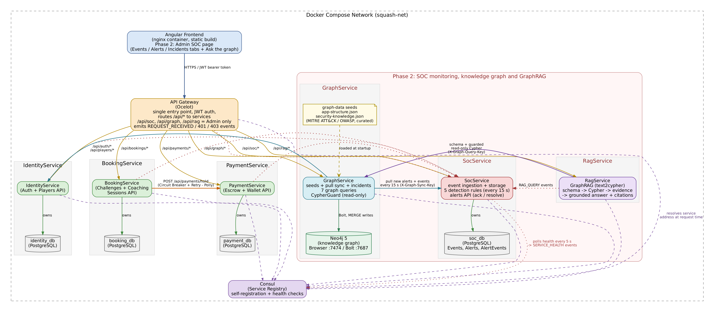
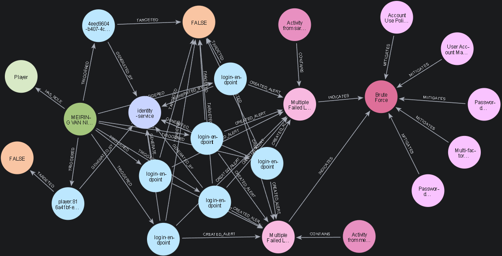
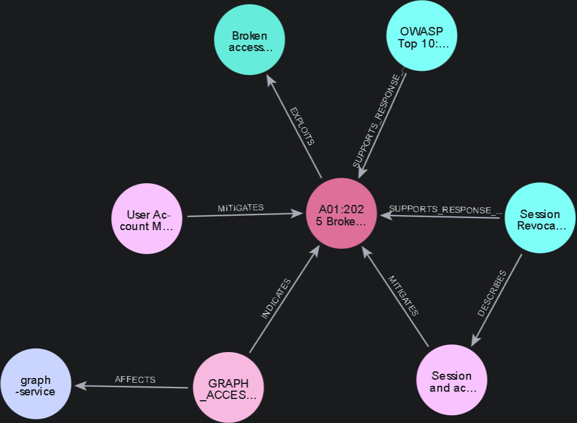

# PotchMatch: SOC Monitoring, Security Knowledge Graph and GraphRAG

A microservices squash platform (.NET 10 + Angular) extended with a **Security Operations Centre**: every service ships security events to a central SOC service, detection rules raise alerts, alerts are linked in a **Neo4j knowledge graph** to MITRE ATT&CK / OWASP threats and controls, and administrators can ask questions in plain English through **GraphRAG** (LLM-generated, guarded, read-only Cypher, with grounded and cited answers).



## Highlights

- **Microservices on Docker Compose**: Ocelot API Gateway, Consul service discovery, Identity / Booking / Payment services, each with its own PostgreSQL database.
- **Resilience patterns**:
  - Polly retry with exponential backoff, a circuit breaker and timeouts on BookingService → PaymentService.
  - A booking/escrow **saga** with a compensating refund.
- **SOC event pipeline**:
  - Each service emits structured Serilog security events.
  - A *durable* HTTP sink ships them to SocService (buffered on disk, retried, authenticated), so nothing is lost while the SOC is down.
- **5 detection rules**, evaluated every 15 s:
  - brute-force logins;
  - unauthorised endpoint access;
  - request floods (POSSIBLE_DOS);
  - service failure (Consul health checks), with auto-resolve on recovery;
  - unauthorised probing of the graph/RAG APIs.
- **Security knowledge graph (Neo4j)**, combining three sources:
  - the application's structure (services, endpoints, dependencies, roles);
  - live users, events and alerts, synced every 15 s;
  - curated **MITRE ATT&CK / OWASP** knowledge.

  Related alerts are correlated into incidents, which are escalated when several rules fire for the same subject.
- **GraphRAG (text2cypher)** with Google Gemini:
  - The live schema, sample values and worked examples go into the prompt.
  - Generated Cypher passes a tokenising **read-only guard** and runs in a read transaction.
  - A rejected query gets one repair attempt.
  - The model never answers when there is no evidence.
  - Every citation is checked against the retrieved nodes.
- **Admin SOC dashboard** (Angular): Events / Alerts / Incidents tabs, acknowledge and resolve alerts, expandable related events, and an *Ask the graph* panel. Each answer shows its evidence: a drawn graph (Cytoscape), the Cypher used, rows and sources.

## Screenshots

| A user's security trail in the knowledge graph | An alert linked to OWASP A01 and its mitigations |
|---|---|
|  |  |

## Tech stack

| Area | Technology |
|---|---|
| Backend | .NET 10, ASP.NET Core Web API, EF Core + Npgsql, Serilog, Polly |
| Gateway & discovery | Ocelot 24, Consul |
| Data | PostgreSQL 16 (one DB per service), Neo4j 5 Community (Neo4j.Driver 6) |
| AI | Google Gemini `generateContent` (JSON mode, temperature 0) |
| Frontend | Angular 22 (standalone components, signals), Cytoscape.js |
| Testing | xUnit + Testcontainers (Neo4j), Vitest |
| Packaging | Docker / Docker Compose, nginx |

## Services

| Service | Responsibility |
|---|---|
| `api-gateway` | Single entry point on `:5132`. Routes `/api/*` via Consul, enforces JWT and roles (SOC, graph and RAG APIs are Admin-only), and records request/401/403 events |
| `identity-service` | Registration, login (JWT), player profiles |
| `booking-service` | Challenges and coaching sessions; orchestrates the escrow saga with PaymentService |
| `payment-service` | Wallets and escrow (hold, release, refund) |
| `soc-service` | Event ingestion and storage, the 5 detection rules, the alerts API, Consul health polling |
| `graph-service` | Owns Neo4j: seeds the graph, pull-syncs SOC data and players, builds incidents, runs 7 named graph queries, and guards RAG Cypher |
| `rag-service` | The GraphRAG pipeline: text2cypher → guarded execution → grounded answer with evidence |
| `frontend` | Angular app (player features plus the admin SOC page) on `:4200` |

## Getting started

**Prerequisites:** Docker Desktop. For the *Ask the graph* feature you also need a free [Gemini API key](https://aistudio.google.com/apikey); without one, everything else still works.

1. Set up the optional key:

   ```bash
   cd backend
   cp .env.example .env        # then set GEMINI_API_KEY in .env
   ```

2. Start the stack:

   ```bash
   docker compose up -d --build
   ```

3. Open the app:

   | What | URL |
   |---|---|
   | App | http://localhost:4200 |
   | API Gateway | http://localhost:5132 |
   | Consul UI | http://localhost:8500 |
   | Neo4j Browser | http://localhost:7474 (`neo4j` / `potchmatch-dev`) |

   Log in as the seeded admin: `admin@potchmatch.local` / `Admin@12345`. These are local development credentials only.

### Demo data

`scripts/seed-demo.ps1` drives realistic traffic through the real APIs. It creates 12 players and coaches (password `Demo@12345`), runs bookings and payments, and then plays attack scenarios that trigger the detection rules. The resulting alerts flow into Neo4j and form incidents, two of them escalated.

```powershell
powershell -ExecutionPolicy Bypass -File scripts\seed-demo.ps1      # Windows
pwsh scripts/seed-demo.ps1                                           # macOS / Linux
```

Options:

- `-SkipFlood` skips the 150-request flood.
- `-IncludeOutage` also stops and restarts `payment-service` to show the circuit breaker and the SERVICE_FAILURE rule.

A Postman collection with every endpoint is in [`postman/`](postman/).

### Running the tests

```bash
dotnet test backend/SquashPlatform.slnx      # Neo4j integration tests need Docker running
cd frontend/squash-frontend && npm ci && npm test
```

## How GraphRAG works

```text
question ──► RagService ──► Gemini: live schema + rules + examples ──► read-only Cypher
                 │
                 ▼
          GraphService  CypherGuard (tokeniser, allow-lists) ──► Neo4j read transaction (10 s, 200 rows)
                 │
                 ▼  rows / nodes / relationships
          Gemini: answer ONLY from this evidence, cite node ids ──► citation check ──► answer + evidence
```

- **No rows, no answer.** An empty result returns "The knowledge graph has no evidence for this question." The model never answers from its own knowledge.
- **Repair once.** A rejected query is sent back to the model with the error for one repair attempt.
- **Untrusted input stays data.** The question and the evidence are passed as labelled JSON data, which hardens the prompts against injection.

The Gemini call is in [`backend/src/RagService/Pipeline`](backend/src/RagService/Pipeline) and the guard is in [`backend/src/GraphService/Rag/CypherGuard.cs`](backend/src/GraphService/Rag/CypherGuard.cs).

## Repository layout

```text
backend/
  docker-compose.yml        whole stack (14 containers)
  src/<Service>/            one ASP.NET Core project per service
  tests/                    xUnit test projects
frontend/squash-frontend/   Angular app (SOC page in src/app/soc)
graph-data/                 Neo4j seeds: app structure + curated MITRE/OWASP knowledge (+ curation script and log)
postman/                    API collection and environment
scripts/                    demo seed script, request-flood script
docs/                       detailed Phase 2 write-up and images
```

## Documentation

- [docs/PHASE1-REPORT.md](docs/PHASE1-REPORT.md) covers the Phase 1 application: functionality, the full API, the architecture, and the three microservice patterns (Database per Service, Circuit Breaker + Retry, Saga).
- [docs/PHASE2-REPORT.md](docs/PHASE2-REPORT.md) is the full Phase 2 write-up. It covers:

  - event collection;
  - every detection rule (purpose, inputs, condition, severity, response);
  - the alert model;
  - the graph model and data sources;
  - the graph queries;
  - the RAG pipeline;
  - design decisions and limitations.

## Background: two phases

Built for the ITRI623 module in two phases. The git history shows both: the first commit is the Phase 1 baseline, and everything after it is Phase 2.

**Phase 1: the microservices application.** Players host fee-based squash challenges, coaches advertise paid coaching sessions, and accepting one holds the fee in escrow and pays out to the host. It's built as an API gateway (Ocelot) in front of Consul-registered Identity, Booking and Payment services, each with its own database, all containerised. It uses three patterns:

- Database per Service;
- Circuit Breaker + Retry (Polly);
- an orchestration Saga with a compensating refund.

| Phase 1 architecture |
|---|
|  |

**Phase 2: security operations.** The system was extended with SOC event collection, detection rules and alerts, a Neo4j security knowledge graph and GraphRAG, as described above.

The security knowledge is derived from [MITRE ATT&CK®](https://attack.mitre.org/) and the [OWASP Top 10:2025](https://owasp.org/Top10/2025/). It was extracted with the Neo4j LLM Graph Builder and then curated; see [`graph-data/knowledge/CURATION.md`](graph-data/knowledge/CURATION.md).
