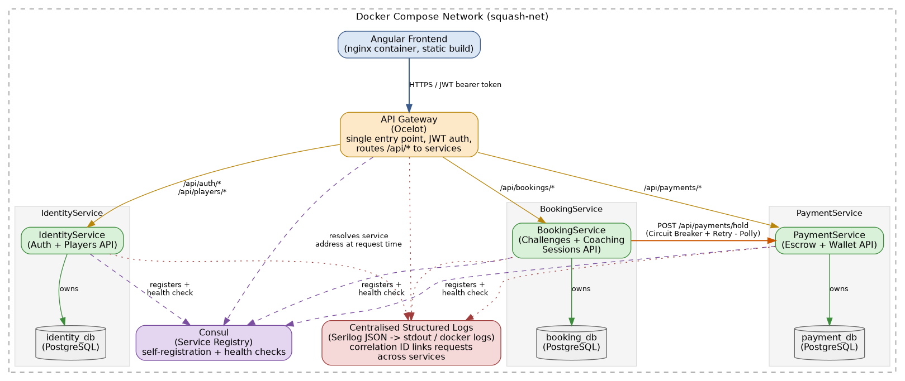

# PotchMatch: Microservice Athlete Tournament & Coaching Hub (MATCH) — Phase 1

**Author:** Meiring van Niekerk · ITRI623, Phase 1 (microservices application)

This document describes the Phase 1 application: the business functionality, API, architecture and the microservice patterns. Phase 2 (SOC monitoring, knowledge graph and GraphRAG) builds on it; see [PHASE2-REPORT.md](PHASE2-REPORT.md) and the [main README](../README.md).

> Paths in this document refer to the Phase 1 layout. In the current repository `docker-compose.yml` lives in `backend/`.

---

## 1. Application functionality

Squash is a growing and competitive sport in South Africa. It is set to become an Olympic sport by 2026. Because it is still a growing sport, players take part in many tournaments, but few professional players earn sufficient income from playing in them alone. Accordingly, the purpose of this project is to create a platform for fee-challenge-based matchmaking, where players can challenge each other to earn income, and coaches can advertise their coaching services to earn income as well, ultimately growing squash as a South African sport. The system is a web application built on a microservices architecture for squash clubs in the North-West province of South Africa, with possible future expansion nationally. Both players and coaches register on the platform. Players can post an open challenge with a fee attached, which any other registered player at the same or a different club can accept and pay to play against them. Coaches can similarly advertise coaching sessions with an hourly fee, which players can book and pay for. Payment is held in escrow by the Payment Service until the session/challenge is accepted, then released to the host, with a simple in-app wallet standing in for a real payment processor.

## 2. API documentation

All client requests go through the API Gateway, which is the only externally-exposed entry point.

**Base URL:** `http://localhost:5132`

All endpoints below are prefixed with this base URL. Endpoints marked 🔒 require a valid JWT bearer token (`Authorization: Bearer <token>`), issued by `POST /api/auth/login`.

### IdentityService — `/api/auth`, `/api/players`

| Method | Endpoint | Description |
|---|---|---|
| POST | `/api/auth/register` | Register a new player or coach account |
| POST | `/api/auth/login` | Authenticate and receive a JWT |
| GET 🔒 | `/api/players` | List all registered players |
| GET 🔒 | `/api/players/{id}` | Get a single player's profile |
| PUT 🔒 | `/api/players/{id}` | Update a player's profile (own profile only) |
| PUT 🔒 | `/api/players/{id}/password` | Change a player's password (own account only) |

**Example — POST `/api/auth/register`**

Request:
```json
{
  "name": "Wickus",
  "surname": "van Niekerk",
  "email": "wickusvn@gmail.com",
  "password": "ne4124ne",
  "clubId": "pcc",
  "isCoach": true
}
```

Response `200 OK`:
```json
{
  "token": "eyJhbGciOiJIUzI1NiIsInR5cCI6IkpXVCJ9...",
  "playerId": "e2854a24-38cf-4a0a-88bd-8bcbc4dd2892",
  "name": "Wickus",
  "surname": "van Niekerk",
  "role": "Coach",
  "clubId": "pcc"
}
```

**Example — POST `/api/auth/login`**

Request:
```json
{ "email": "wickusvn@gmail.com", "password": "ne4124ne" }
```

Response `200 OK`: same shape as register above. Response `401 Unauthorized` on bad credentials.

### BookingService — `/api/bookings`

| Method | Endpoint | Description |
|---|---|---|
| GET 🔒 | `/api/bookings?clubId={id}` | List bookings, optionally filtered by club |
| GET 🔒 | `/api/bookings/{id}` | Get a single booking (challenge or coaching session) |
| POST 🔒 | `/api/bookings` | Host a new challenge or coaching session |
| PUT 🔒 | `/api/bookings/{id}/accept` | Accept an open booking (holds payment in escrow) |

**Example — POST `/api/bookings`**

Request:
```json
{
  "clubId": "pcc",
  "feeZAR": 100,
  "scheduledAt": "2026-09-07T09:00:00Z",
  "proposedLocation": "PCC Court 1",
  "isCoachingSession": true
}
```

Response `201 Created`:
```json
{
  "id": "cb0cfe1c-d7d1-4aff-9c1d-4fb31c91c09a",
  "clubId": "pcc",
  "hostPlayerId": "5e9a...",
  "opponentPlayerId": null,
  "feeZAR": 100,
  "status": "Open",
  "proposedLocation": "PCC Court 1",
  "isCoachingSession": true,
  "scheduledAt": "2026-09-07T09:00:00Z",
  "createdAt": "2026-09-05T22:02:36Z"
}
```

**Example — PUT `/api/bookings/{id}/accept`**

No request body. Response `200 OK` with the updated booking (`status: "Accepted"`), `402 Payment Required` if the accepting player's wallet balance is too low, or `409 Conflict` if someone else already accepted it first.

### PaymentService — `/api/payments`

| Method | Endpoint | Description |
|---|---|---|
| GET 🔒 | `/api/payments/{id}` | Get a single escrow transaction |
| GET 🔒 | `/api/payments/by-booking/{bookingId}` | Get the escrow transaction for a booking |
| GET 🔒 | `/api/payments/wallet` | Get the caller's own wallet balance |
| POST 🔒 | `/api/payments/wallet/deposit` | Top up the caller's own wallet (demo only, no real card processing) |
| POST 🔒 | `/api/payments/hold` | Hold funds in escrow for a booking (called by BookingService) |
| PUT 🔒 | `/api/payments/{id}/release` | Release held funds to the payee |
| PUT 🔒 | `/api/payments/{id}/refund` | Refund held funds to the payer |

**Example — GET `/api/payments/wallet`**

Response `200 OK`:
```json
{ "balanceZAR": 0.00 }
```

**Example — POST `/api/payments/wallet/deposit`**

Request:
```json
{ "amountZAR": 200 }
```

Response `200 OK`:
```json
{ "balanceZAR": 200.00 }
```

## 3. Architecture diagram



The diagram shows:

- the Angular client/frontend calling the system only through the API Gateway;
- the API Gateway (Ocelot) as the single entry point, handling JWT authentication and routing `/api/auth`, `/api/players`, `/api/bookings` and `/api/payments` to the correct downstream service;
- Consul as the service registry — every domain service self-registers on startup and is health-checked, and the Gateway resolves each service's address through Consul at request time rather than a hardcoded host/port;
- the three domain services (IdentityService, BookingService, PaymentService), each in its own container;
- one PostgreSQL database per service (`identity_db`, `booking_db`, `payment_db`), with no service reaching into another's database;
- the inter-service call from BookingService to PaymentService (`POST /api/payments/hold`, then `/release` or `/refund`), wrapped in a circuit breaker + retry policy and forming the orchestration-based Saga described in Section 4;
- centralised structured logging — every service writes JSON logs (via Serilog) to stdout/Docker logs, and a correlation ID threads a single request across every service it touches.

## 4. Microservices patterns implemented

Three patterns were implemented at the application/observability level (the API Gateway itself is not counted as one of these, per the brief) — one more than the minimum of two required, since the "accept a booking" workflow naturally needed a third:

### Pattern 1: Database per Service

Each of the three domain services owns an entirely separate PostgreSQL database (`identity_db`, `booking_db`, `payment_db`), each running in its own container with its own volume (see `docker-compose.yml`). No service holds a connection string to another service's database, and no service's Entity Framework `DbContext` references another service's tables. For example, BookingService knows a `HostPlayerId` (a `Guid`) on a booking, but it has no way to query player details directly — if it needs that data, it would have to call IdentityService's API, not its database.

**Why this improves loose coupling and independent deployment:** each service's schema can change, be migrated, or be scaled independently without any coordination with the other services' databases. A schema change in `booking_db` (for example, the `AddScheduledAtToBookings` migration we added) never risks breaking IdentityService or PaymentService, because they have no way to see it. It also means each service could, in principle, move to a different database engine entirely without affecting the others.

**Evidence:** `docker-compose.yml` defines three separate Postgres containers and volumes (`identity-db`, `booking-db`, `payment-db`); each service's `appsettings.json`/environment variables only ever reference its own connection string.

### Pattern 2: Circuit Breaker + Retry (resilience pattern)

When BookingService calls PaymentService to hold funds in escrow (`POST /api/payments/hold`), the call goes through a Polly resilience pipeline configured in `BookingService/Program.cs`:

- **Retry:** up to 3 attempts with exponential backoff, for transient failures (5xx responses, timeouts, connection errors).
- **Circuit Breaker:** if over 50% of calls fail within a 10-second window (minimum 3 calls), the circuit opens for 15 seconds and further calls fail immediately with a `503`, instead of continuing to hammer a struggling PaymentService.
- **Timeout:** each individual attempt is capped at 5 seconds.

Deliberate business responses (like `402 Insufficient Funds`) are explicitly excluded from what counts as a "failure" for this pipeline, since retrying a deterministic business rejection is pointless — only real infrastructure failures (5xx, timeouts, connection errors) trip the breaker.

**Why this matters:** without this, a slow or temporarily-down PaymentService would cause every booking-accept request to hang or fail outright, and repeated failed calls would keep making things worse. With it, BookingService fails fast once it detects PaymentService is struggling, and recovers automatically once PaymentService comes back.

**Evidence:** this was proven working live during development — a test call correctly received `402 Insufficient Funds` from PaymentService, and the resulting structured logs show the full pipeline in action: `OnRetry`, `OnCircuitOpened`, and the `BrokenCircuitException` being caught and turned into a clean `503` response, all visible with a shared `CorrelationId` linking the BookingService and PaymentService log lines for that one request.

### Pattern 3: Saga Pattern (orchestration-based, with compensating transaction)

Accepting a booking is a single business action that has to touch data owned by two different services — a status change in `booking_db` and a movement of money in `payment_db` — and, because of Database per Service (Pattern 1), there is no shared database transaction that could ever cover both. This is exactly the problem the Saga pattern exists for, and `BookingController.Accept()` (`BookingService/Controllers/BookingController.cs`) implements it in orchestration style, with BookingService itself acting as the orchestrator that drives every step and decides how to recover when one of them fails:

1. **Step 1 — hold funds:** BookingService calls `POST /api/payments/hold` on PaymentService, which places the booking fee into escrow and returns an `EscrowTransactionResponse` (the local step in PaymentService's own database).
2. **Step 2 — local step:** BookingService then attempts its own local step: an atomic conditional update (`WHERE Status = Open`) that flips the booking to `Accepted` for this opponent. This also doubles as the concurrency guard against two players accepting the same booking at once.
3. **Compensating transaction:** if step 2 reports zero rows affected, it means another opponent won the race between step 1 and step 2 — so BookingService compensates by calling `PUT /api/payments/{id}/refund` to undo the escrow hold it created in step 1, and returns `409 Conflict` to the loser. Money already held is not left stranded just because the booking itself could no longer go ahead.
4. **Forward completion:** if step 2 succeeds, BookingService calls `PUT /api/payments/{id}/release` so the escrowed funds actually move into the host's wallet (minus commission), completing the saga.

**Why this matters:** without an explicit saga, a failure partway through this workflow could easily leave the system in an inconsistent state — for example, money held in escrow for a booking that was never actually accepted, with no service responsible for putting it right. Making BookingService the orchestrator keeps that recovery logic in one place, next to the business rule it protects, rather than relying on PaymentService to guess why a hold was never followed up.

**Evidence:** `BookingService/Controllers/BookingController.cs`, `Accept()` action — the hold call, the conditional update, and both the refund (compensating) and release (forward) follow-up calls are all in this one method, each emitting its own `SecurityEventLog` event (`BOOKING_ACCEPT_LOST_RACE`, `BOOKING_ACCEPTED`) so the saga's outcome is visible in the structured logs too.

## 5. How security events are collected

Every one of the four services (ApiGateway, IdentityService, BookingService, PaymentService) is configured with Serilog to write structured JSON log lines to stdout (visible via `docker compose logs <service>` or Docker Desktop). Every log line carries a `ServiceName` property and a `CorrelationId` — a single ID minted at the Gateway (or reused if the client already supplied one) and forwarded automatically to every downstream service call for that request, so one user action can be traced end-to-end across services in the logs.

Beyond the generic `REQUEST_RECEIVED`/`REQUEST_COMPLETED` pair every request gets (including status code and response time), specific security- and business-relevant events are logged individually through a shared `SecurityEventLog.Emit(...)` helper, using a fixed event shape:

```
eventId, timestamp, serviceName, eventType, severity, userId, sourceIp,
endpoint, httpMethod, statusCode, message, correlationId, affectedEntity
```

This shape was chosen deliberately to match what a future SOC event-collection layer would need (Section 9 of the spec) — no rework should be needed to feed these logs into that later phase.

Examples of events currently captured:

- **Authentication:** `LOGIN_SUCCESS`, `FAILED_LOGIN` (IdentityService, on every login attempt).
- **Authorisation:** `AUTH_TOKEN_REJECTED`, `UNAUTHORISED_ACCESS` (e.g. a non-coach trying to post a coaching session, or a player trying to edit someone else's profile).
- **Suspicious activity:** `SUSPICIOUS_ACTIVITY` (e.g. a player attempting to accept their own booking).
- **Business events:** `PLAYER_REGISTERED`, `BOOKING_CREATED`, `BOOKING_ACCEPTED`, `ESCROW_HELD`, `ESCROW_RELEASED`, `ESCROW_REFUNDED`.
- **Inter-service reliability:** `INTER_SERVICE_CALL` (before calling another service), `INTER_SERVICE_CALL_FAILED` (a downstream call failed or the circuit breaker tripped).
- **Unhandled errors:** every unhandled exception is logged with a full message and stack context before the default error handling takes over.

These logs are currently inspected through `docker compose logs` / Docker Desktop's log viewer (satisfying the "central place or consistent logging approach" requirement without needing a separate log aggregation tool for this deliverable), but because every line is structured JSON, they could be shipped as-is into Seq, the ELK stack, or Grafana Loki with no changes to the services themselves.
