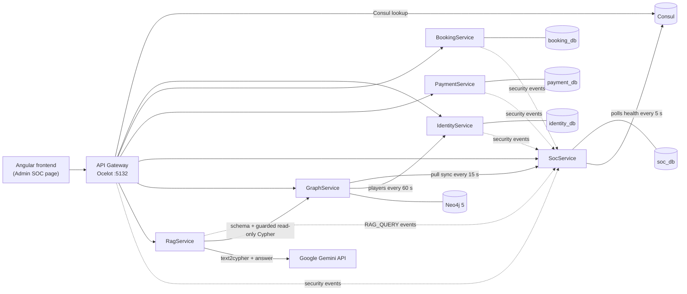

# PotchMatch: SOC Monitoring, Security Knowledge Graph and GraphRAG

**Author:** Meiring van Niekerk · ITRI623 (Advanced Software Engineering / Microservices), Phase 2

This document describes the Phase 2 additions in detail. For a quick overview and run instructions, see the [main README](../README.md).

---

## 1. Overview

Phase 1 delivered PotchMatch, a microservices squash-matchmaking platform: an Angular frontend, an Ocelot API Gateway, Consul service discovery, and three domain services (IdentityService, BookingService, PaymentService), each with its own PostgreSQL database, all running in Docker Compose.

Phase 2 treats that system as an operational environment that must be monitored. Four capabilities were added, one per part of the specification:

| Spec part | What was built | Component |
|---|---|---|
| 3.1–3.2 Event collection and storage | Every service ships structured security events to a central SOC store | Serilog durable HTTP sink → **SocService** (`soc_db`) |
| 3.3–3.4 Detection rules and alerts | Five rules evaluated every 15 s; alerts stored, displayed and acknowledged | **SocService** detection engine + admin SOC page |
| 4 Knowledge graph | Neo4j graph combining application structure, live events/alerts and curated MITRE/OWASP knowledge | **Neo4j 5** + **GraphService** |
| 5 RAG | Natural-language questions answered from graph evidence (Cypher-based GraphRAG, Option A) | **RagService** (Google Gemini) |

All new services register in Consul and are reached only through the API Gateway. The SOC, graph and RAG APIs are restricted to the **Admin** role.

### 1.1 Architecture


The same architecture as a Mermaid diagram (renders in Markdown viewers that support Mermaid):



*Dotted lines:* events pushed by the Serilog sink. *Solid lines:* synchronous HTTP calls.

| Container | Port | Role |
|---|---|---|
| `api-gateway` | 5132 | Single entry point; routes `/api/soc`, `/api/graph`, `/api/rag` (Admin only) as well as the Phase 1 routes |
| `soc-service` + `soc-db` | internal / 5436 | Event ingestion, storage, detection rules, alerts |
| `neo4j` | 7474 (Browser), 7687 (Bolt) | Knowledge graph |
| `graph-service` | internal | Seeds the graph, syncs events/alerts/players, builds incidents, runs the graph queries, guards RAG Cypher |
| `rag-service` | internal | GraphRAG pipeline using Gemini |
| `frontend` | 4200 | Phase 1 UI plus the Admin SOC page |

---

## 2. SOC event collection (spec 3.1)

### 2.1 How events are collected

Every service already logged structured JSON with Serilog in Phase 1. In Phase 2 a security event is a Serilog log entry carrying a `SecurityEvent` property. Each service has a second Serilog pipeline that sends **only** these entries to SocService:

```csharp
.WriteTo.Logger(lc => lc
    .Filter.ByIncludingOnly(Matching.WithProperty("SecurityEvent"))
    .WriteTo.DurableHttpUsingFileSizeRolledBuffers(
        requestUri: "http://soc-service:8080/api/events",
        bufferBaseFileName: "/tmp/soc-buffer/events",
        batchFormatter: new ArrayBatchFormatter(),
        httpClient: new SocIngestHttpClient(context.Configuration))));
```

Why it is built this way:

- **Durable.** Events are buffered on disk and retried, so no events are lost while SocService is down or restarting.
- **Authenticated.** Each batch carries an `X-Soc-Ingest-Key` header. SocService rejects batches with a missing or wrong key (401).
- **Not blocking.** Shipping happens in the background, so a slow SocService never delays a user request.
- **One correlation ID.** The `CorrelationId` from Phase 1 travels with every event, so one request can be followed across the gateway and the downstream services.

SocService maps each Serilog envelope onto the specification's event structure and stores it in `soc_db`.

### 2.2 Sources and event types

| Source (spec requirement) | Event types |
|---|---|
| **API Gateway** | `REQUEST_RECEIVED` (every request), `AUTH_TOKEN_REJECTED` (401: missing, expired or invalid JWT), `UNAUTHORISED_ACCESS` (403: wrong role) |
| **Authentication service** (IdentityService) | `PLAYER_REGISTERED`, `LOGIN_SUCCESS`, `FAILED_LOGIN`, `FAILED_PASSWORD_CHANGE`, `UNAUTHORISED_ACCESS`, `UNHANDLED_EXCEPTION` |
| **Domain service 1** (BookingService) | `BOOKING_CREATED`, `BOOKING_ACCEPTED`, `BOOKING_ACCEPT_BLOCKED_INSUFFICIENT_FUNDS`, `BOOKING_ACCEPT_LOST_RACE`, `SUSPICIOUS_ACTIVITY`, `INTER_SERVICE_CALL`, `INTER_SERVICE_CALL_FAILED`, `UNHANDLED_EXCEPTION` |
| **Domain service 2** (PaymentService) | `WALLET_DEPOSIT`, `ESCROW_HELD`, `ESCROW_RELEASED`, `ESCROW_REFUNDED`, `ESCROW_HOLD_BLOCKED_INSUFFICIENT_FUNDS`, `DUPLICATE_ESCROW_HOLD_ATTEMPT`, `UNHANDLED_EXCEPTION` |
| **Container / service health** | `SERVICE_HEALTH_CRITICAL`, `SERVICE_HEALTH_RECOVERED`. SocService polls Consul's health checks every 5 s and records an event on every state change. |
| **RagService** | `RAG_QUERY` (LOW): the outcome, attempt count and latency of each question. The question text, prompts and API key are never logged. |

### 2.3 Event structure

Every stored event has the 13 fields required by the specification. Example: a failed login stored by SocService.

```json
{
  "eventId": "0f1e2d3c-5b6a-4c8d-9e0f-1a2b3c4d5e6f",
  "timestamp": "2026-10-14T10:02:00Z",
  "serviceName": "identity-service",
  "eventType": "FAILED_LOGIN",
  "severity": "MEDIUM",
  "userId": "wickusvn@gmail.com",
  "sourceIp": "172.18.0.1",
  "endpoint": "/api/auth/login",
  "httpMethod": "POST",
  "statusCode": 401,
  "message": "Invalid email or password for login attempt as wickusvn@gmail.com",
  "correlationId": "9a8b7c6d-1111-2222-3333-444455556666",
  "affectedEntity": "login-endpoint"
}
```

---

## 3. SOC storage and inspection (spec 3.2)

The SOC log is built in-house rather than with an external platform such as Better Stack:

- **Storage:** PostgreSQL `soc_db` (tables `Events`, `Alerts` and `AlertEvents`, the link table between alerts and their events).
- **API** (through the gateway, Admin only):

| Method | Endpoint | Purpose |
|---|---|---|
| GET | `/api/soc/events?type=&user=&from=&to=&excludeType=&alertId=&page=&pageSize=` | Search events: newest first, 50 per page, maximum 200 |
| GET | `/api/soc/alerts?status=&severity=&ruleName=` | List alerts |
| GET | `/api/soc/alerts/{id}` | One alert with its related events |
| PATCH | `/api/soc/alerts/{id}/status` | Acknowledge or resolve an alert |
| GET | `/api/soc/rules` | Self-documentation of every detection rule (name, purpose, inputs, condition, severity, response) |

- **Dashboard:** the Admin **SOC page** in the frontend has three tabs: **Events** (the 13 spec fields, with filters and paging), **Alerts** (the 11 spec fields; expand a row to see its related events), and **Incidents (from the knowledge graph)**.

---

## 4. Threat detection rules (spec 3.3 / 11.4)

A background worker in SocService runs every enabled rule over the recent events **every 15 seconds**. Each rule returns zero or more matches, and each match has a **deduplication key** (for example `Multiple Failed Logins:account:wickusvn@gmail.com`). While an alert with that key is still OPEN, new matching events are added to it instead of creating a duplicate alert. All thresholds are configurable in `appsettings.json` (`DetectionRules`).

### Rule 1: Multiple Failed Logins

| | |
|---|---|
| **Purpose** | Detect brute-force or credential-stuffing attempts against the login endpoint. |
| **Input events** | `FAILED_LOGIN` (IdentityService) |
| **Detection condition** | 5 or more `FAILED_LOGIN` events within 5 minutes for the same target account, or for the same source IP |
| **Severity** | HIGH |
| **Alert generated** | "Multiple Failed Logins". Affected service `identity-service`, affected user = the targeted account, affected entity `/api/auth/login`, linked to the failed-login events |
| **Recommended response** | Temporarily block the source IP and verify whether the account is compromised; consider forcing a password reset. |

### Rule 2: Unauthorised Endpoint Access

| | |
|---|---|
| **Purpose** | Detect users or clients repeatedly trying to reach endpoints they are not authorised for. |
| **Input events** | `AUTH_TOKEN_REJECTED` (401), `UNAUTHORISED_ACCESS` (403) |
| **Detection condition** | 3 or more such events within 5 minutes for the same user (by source IP when there is no user). Requests to `/api/graph/` and `/api/rag/` are left to Rule 5. |
| **Severity** | MEDIUM |
| **Alert generated** | "Unauthorised Endpoint Access", naming the user or IP. Affected service = the most targeted service; affected entity = the last endpoint tried. |
| **Recommended response** | Review the user's role assignments and recent activity; revoke the session if access attempts continue. |

### Rule 3: Abnormal Request Rate (POSSIBLE_DOS)

| | |
|---|---|
| **Purpose** | Detect request floods from a single source that may indicate a denial-of-service attempt. |
| **Input events** | `REQUEST_RECEIVED` (API Gateway) |
| **Detection condition** | More than 100 requests at the gateway within 60 seconds from the same source IP |
| **Severity** | HIGH |
| **Alert generated** | "POSSIBLE_DOS", naming the source IP, linked to the gateway request events |
| **Recommended response** | Rate-limit or temporarily block the source IP at the gateway. |

### Rule 4: Service Failure (SERVICE_FAILURE)

| | |
|---|---|
| **Purpose** | Detect a backend service that is down or repeatedly failing, and clear the alert when it recovers. |
| **Input events** | `SERVICE_HEALTH_CRITICAL`, `SERVICE_HEALTH_RECOVERED`, `INTER_SERVICE_CALL_FAILED`, `UNHANDLED_EXCEPTION` |
| **Detection condition** | Any `SERVICE_HEALTH_CRITICAL` event, or 3 or more call failures / unhandled exceptions for the same service within 2 minutes, with no later `SERVICE_HEALTH_RECOVERED` |
| **Severity** | HIGH |
| **Alert generated** | "SERVICE_FAILURE", naming the service. **Auto-resolved** when the service reports recovery. |
| **Recommended response** | Check the affected service's container and logs; dependent services are degraded until it recovers. |

### Rule 5: Suspicious Graph Query (GRAPH_ACCESS)

| | |
|---|---|
| **Purpose** | Detect someone probing the knowledge graph or RAG interface without authorisation (reconnaissance of users, dependencies and incidents). |
| **Input events** | `AUTH_TOKEN_REJECTED`, `UNAUTHORISED_ACCESS` on endpoints starting with `/api/graph/` or `/api/rag/` |
| **Detection condition** | 3 or more denied requests to those endpoints within 5 minutes for the same user (by source IP when anonymous) |
| **Severity** | HIGH |
| **Alert generated** | "GRAPH_ACCESS". Affected service `graph-service` or `rag-service` (whichever was targeted more); affected entity = the last endpoint tried |
| **Recommended response** | Review the account's role and recent activity; revoke its sessions and block the source IP if the attempts were not expected. |

**Design choice for Rule 5:** the graph and RAG APIs are Admin-only, so a non-admin touching them is more suspicious than an ordinary 403. Rule 5 therefore splits these denials out of Rule 2 and raises them at HIGH severity. It maps to OWASP A01:2025 Broken Access Control in the graph.

---

## 5. Alert service (spec 3.4)

Alerts are stored in SocService (`Alerts` table) and linked to their events through `AlertEvents`. Each alert carries the 11 fields required by the specification. Example produced by Rule 1:

```json
{
  "alertId": "7c1d2e3f-4a5b-4c6d-8e7f-9a0b1c2d3e4f",
  "timestamp": "2026-10-14T10:05:00Z",
  "ruleName": "Multiple Failed Logins",
  "severity": "HIGH",
  "status": "OPEN",
  "description": "5 failed login attempts for wickusvn@gmail.com within 5 minutes.",
  "relatedEvents": ["0f1e2d3c-…", "1a2b3c4d-…", "2b3c4d5e-…", "3c4d5e6f-…", "4d5e6f70-…"],
  "affectedService": "identity-service",
  "affectedUser": "wickusvn@gmail.com",
  "affectedEntity": "/api/auth/login",
  "recommendedAction": "Temporarily block the source IP and verify whether the account is 
  compromised; consider forcing a password reset."
}
```

**Alert lifecycle:** `OPEN` → `ACKNOWLEDGED` → `RESOLVED`. The admin changes the status from the SOC page or through `PATCH /api/soc/alerts/{id}/status`. SERVICE_FAILURE alerts are resolved automatically when the service recovers.

**Display:** the **Alerts** tab shows the 11 fields with status and severity filters, refreshing every 30 s. Clicking a row expands its description, its recommended action, and its related events with all 13 event fields. **Why?** sends the alert to the RAG panel as context.

---

## 6. Knowledge graph (spec 4 / 11.3)

### 6.1 Graph model

The graph runs in **Neo4j 5 Community**. GraphService owns it: it creates uniqueness constraints, loads the seeds, keeps the graph in sync with SocService and IdentityService, and exposes the queries.

| Label | Key property | Important properties | Source |
|---|---|---|---|
| `User` | `userId` | `name`, `email`, `unknownAccount` | IdentityService sync (players); events (unknown accounts) |
| `Role` | `name` | (Player, Coach, Admin) | App structure seed |
| `Service` | `name` | `kind` | App structure seed |
| `Endpoint` | `key` (for example `POST /api/auth/login`) | `method`, `path`, `protected` | App structure seed |
| `Asset` | `name` | `type` (database or registry) | App structure seed |
| `Event` | `eventId` | the 13 spec event fields | SocService sync |
| `Alert` | `alertId` | the 11 spec alert fields | SocService sync |
| `Incident` | `incidentId` | `title`, `subject`, `severity`, `status`, `escalated`, `priority`, `openedAt`, `lastAlertAt` | Built by GraphService |
| `Threat` | `id` (MITRE technique / OWASP id) | `name`, `description`, `origin` | Security knowledge seed |
| `Control` | `id` (MITRE mitigation / `CTRL-*`) | `name`, `description`, `origin` | Security knowledge seed |
| `Vulnerability` | `id` (`VULN-*`) | `name`, `description` | Security knowledge seed |
| `Document` | `id` (`DOC-*`) | `title`, `kind` (web page or procedure), `url` | Security knowledge seed |

**Relationships.** All 14 relationship types from the specification are used. Three more were added where the specification's set could not express a link:

```text
(:User)-[:TRIGGERED]->(:Event)              (:Event)-[:GENERATED_BY]->(:Service)
(:Event)-[:TARGETED]->(:Endpoint)           (:Event)-[:CREATED_ALERT]->(:Alert)
(:Alert)-[:INDICATES]->(:Threat)            (:Threat)-[:TARGETS]->(:Service)
(:Threat)-[:EXPLOITS]->(:Vulnerability)     (:Control)-[:MITIGATES]->(:Threat)
(:Incident)-[:CONTAINS]->(:Alert)           (:Service)-[:DEPENDS_ON]->(:Service)
(:Service)-[:EXPOSES]->(:Endpoint)          (:User)-[:HAS_ROLE]->(:Role)
(:Document)-[:DESCRIBES]->(:Control)        (:Document)-[:SUPPORTS_RESPONSE_TO]->(:Threat)

Added:
(:Alert)-[:AFFECTS]->(:Service)             -- the alert's affectedService, used by "alerts affecting a service"
(:Service)-[:USES]->(:Asset)                -- service → its database / registry
(:Endpoint)-[:REQUIRES_ROLE]->(:Role)       -- which role an endpoint needs
```

**How application entities connect to security knowledge.** The chain from a user's action to a recommended control is:

```text
(User)-[:TRIGGERED]->(Event)-[:CREATED_ALERT]->(Alert)-[:INDICATES]->(Threat)<-[:MITIGATES]-(Control)
                       |                          |                     |
              [:GENERATED_BY]/[:TARGETED]     [:AFFECTS]          [:TARGETS]/[:EXPLOITS]
                 Service / Endpoint             Service          Service / Vulnerability
                                                                 (Document)-[:SUPPORTS_RESPONSE_TO]->(Threat)
```

A user's security trail in Neo4j Browser (user → failed-login events → *Multiple Failed Logins* alerts → T1110 Brute Force ← mitigating controls, with the incidents that contain the alerts):


A GRAPH_ACCESS alert linked to OWASP A01:2025 Broken Access Control, its mitigating controls, the exploited vulnerability and the response procedure:


### 6.2 Graph data sources (spec 4.3)

| # | Source | How it enters the graph | Size |
|---|---|---|---|
| 1 | **Application structure from Phase 1** | Seed `graph-data/app-structure.json`, loaded at startup: 7 services, 31 endpoints, 6 assets, 3 roles; 10 `DEPENDS_ON`, 31 `EXPOSES`, 14 `REQUIRES_ROLE`, 11 `USES`, 11 `TARGETS` | 51 nodes / 77 relationships |
| 2 | **Phase 2 events and alerts** | GraphService pulls new alerts (with their events) and other security events from SocService every 15 s, and players from IdentityService every 60 s. Writes are idempotent `MERGE`s, and a sync cursor is stored in the graph. `REQUEST_RECEIVED` and `RAG_QUERY` events are only synced when they belong to an alert, which keeps noise out of the graph. | Grows with activity |
| 3 | **Formal security documentation** | MITRE ATT&CK and OWASP pages extracted with the Neo4j **LLM Graph Builder**, then curated (below) into `graph-data/knowledge/security-knowledge.json` | 48 nodes / 93 relationships |

**Security knowledge pipeline (source 3):**

1. **Sources.** 11 official pages:
   - MITRE ATT&CK techniques T1110 (Brute Force), T1110.001, T1110.003, T1110.004, T1078 (Valid Accounts) and T1499 (Endpoint DoS);
   - mitigations M1036, M1032 (MFA), M1027 and M1037;
   - OWASP Top 10:2025 A01 Broken Access Control.

   Four PotchMatch response procedures were written as Markdown: password reset, session revocation, IP blocking and the service outage runbook.
2. **Extraction.** The Neo4j LLM Graph Builder, run locally, extracted 1,427 raw nodes and 1,100 relationships from these documents.
3. **Curation.** `curate.py` kept only the threats PotchMatch detects and their sub-techniques, mitigations and vulnerabilities, plus one Document per source. It merged naming variants (for example "Brute Force", "Brute Force (T1110)" and "T1110 Brute Force" became one node) and checked each MITIGATES link against MITRE's own mitigation list.

   Every change is recorded in `CURATION.md`. 43 of the 48 nodes and 68 of the 93 relationships come straight from extraction; the rest were added by hand, each with a justification.
4. **Linking to live data.** Each rule is mapped to a threat: Multiple Failed Logins → T1110, Unauthorised Endpoint Access → T1078, POSSIBLE_DOS and SERVICE_FAILURE → T1499, GRAPH_ACCESS → OWASP-A01-2025. Every synced alert therefore gets an `INDICATES` link into the curated knowledge.

**Event → graph mapping.** For each synced event, GraphService links:

- `GENERATED_BY` to its service;
- `TARGETED` to the endpoint, normalising the path to the template, for example `/api/bookings/3f2…/accept` → `PUT /api/bookings/{id}/accept`;
- `TRIGGERED` from the user, matched by player ID or by email. A failed login for an email with no account creates a `User` with `unknownAccount: true`, which is merged into the real player if that email later registers.

### 6.3 Incidents

Incidents are not records in the SOC database; they are built in the graph. GraphService groups alerts by **subject**: the affected user, otherwise the most frequent source IP, otherwise the service. Alerts for the same subject within a **30-minute** window join one `Incident` through `(:Incident)-[:CONTAINS]->(:Alert)`.

When two or more different rules fire for the same subject (for example failed logins followed by unauthorised access by the same user), the incident is marked **escalated** with priority **HIGH**. This covers the scenario item "creation or escalation of high-priority incidents" and the questions about wider incidents.

### 6.4 Graph queries (spec 4.4)

Seven parameterised Cypher queries are exposed through GraphService (Admin only, through the gateway). Each response returns the Cypher, its parameters, the result rows, and the nodes and relationships traversed, so it can be shown as evidence.

| # | Spec example | Endpoint | Core Cypher |
|---|---|---|---|
| 1 | Show all alerts affecting a service | `GET /api/graph/services/{name}/alerts` | `MATCH p=(a:Alert)-[:AFFECTS]->(s:Service {name:$name}) RETURN p, a.ruleName, a.severity, …` |
| 2 | Show users linked to high-severity alerts | `GET /api/graph/users/high-severity` | `MATCH p=(u:User)-[:TRIGGERED]->(:Event)-[:CREATED_ALERT]->(a:Alert) WHERE toUpper(a.severity)='HIGH' …` |
| 3 | Find threats linked to a service | `GET /api/graph/services/{name}/threats` | `(t:Threat)-[:TARGETS]->(s)` UNION `(s)<-[:AFFECTS]-(a:Alert)-[:INDICATES]->(t:Threat)` |
| 4 | Find controls for an alert | `GET /api/graph/alerts/{id}/controls` | `(a:Alert {alertId:$alertId})-[:INDICATES]->(t)<-[:MITIGATES]-(c:Control)` + describing documents, response procedures and exploited vulnerabilities |
| 5 | Find dependency impact | `GET /api/graph/services/{name}/impact` | `MATCH p=(dep:Service)-[:DEPENDS_ON*1..]->(s:Service {name:$name}) RETURN dep.name, min(length(p))` |
| 6 | List incidents | `GET /api/graph/incidents?status=` | `MATCH (i:Incident) WHERE $status IS NULL OR i.status=$status …` |
| 7 | Incident detail (users, services, threats) | `GET /api/graph/incidents/{id}` | `(i:Incident)-[:CONTAINS]->(a:Alert)` + triggering users, affected services and indicated threats |

All seven are in the Postman collection, folder **Phase 2 — Graph**.

---

## 7. RAG over the knowledge graph (spec 5 / 11.6)

### 7.1 Pattern: Cypher-based GraphRAG (Option A, text2cypher)

The admin types a question on the SOC page (or clicks **Why?** on an alert or **Ask** on an incident). **RagService** then runs this pipeline:

1. **Schema.** It fetches the live graph schema from GraphService: labels, relationship types, property keys, a few sample values, and example queries. The schema is cached for 10 minutes.
2. **Generate Cypher.** Gemini receives the schema, rules and the question (as a JSON string, so the question cannot break out of the prompt). It returns **one read-only, parameterised Cypher query** plus a one-line explanation, in JSON mode at temperature 0. If the question came from an alert or incident, `$alertId` / `$incidentId` are forced from the request and the model cannot override them.
3. **Guard and execute.** The Cypher is sent to GraphService's internal `/api/internal/query` endpoint, protected by a shared key. A tokenising **CypherGuard** rejects anything that is not a pure read:
   - write and admin keywords (`CREATE`, `MERGE`, `DELETE`, `SET`, `LOAD CSV`, `SHOW`, `TERMINATE`, `INSERT`, …);
   - any `CALL` outside an allow-list of three schema procedures;
   - functions outside an allow-list;
   - control characters.

   Accepted queries still run in a Neo4j **read transaction** with a 10 s timeout and a 200-row cap.
4. **One repair attempt.** If the guard or Neo4j rejects the query, the error is sent back to Gemini once to fix it.
5. **No evidence, no answer.** If the query returns no rows and no nodes, the system answers "The knowledge graph has no evidence for this question." It never lets the model answer from its own knowledge.
6. **Grounded answer.** Gemini receives only the retrieved evidence (at most 50 rows, 80 nodes and 150 relationship triples, JSON-escaped) and must answer from it alone, citing node IDs in square brackets.
7. **Citation check.** Every cited ID is checked against the retrieved nodes. Unknown ones are listed as `unverifiedCitations` and shown as a warning.

This is a **Cypher-based retrieval** (graph traversal by generated Cypher). It uses no vector index and no embeddings, so the retrieval step is fully explainable: the exact query, its parameters and every row it returned are shown.

### 7.2 Evidence shown (spec 5.3)

Each answer on the SOC page shows:

| Spec requirement | What is displayed |
|---|---|
| Retrieved nodes | Cytoscape graph drawing of the nodes, and the rows table |
| Retrieved relationships | The drawn edges, plus a list of `(A)-[:TYPE]->(B)` triples |
| Source documents / procedures | `Document` nodes in the evidence, with links to the MITRE/OWASP pages |
| Retrieval method / confidence | Method ("LLM-generated Cypher, validated read-only, executed on Neo4j"), model, attempts (1 = first try, 2 = repaired), row count, truncation flag, the model's one-line explanation, unverified citations |

The generated **Cypher** and **parameters** are shown as well, so the retrieval can be re-run by hand in Neo4j Browser.

### 7.3 Demonstration questions

Three demonstration questions (run with `gemini-3.5-flash-lite`). For each, the retrieval path and the evidence the graph returns:

**Question 1 — "Why was this alert created and what should be done?"** (asked with **Why?** on a Multiple Failed Logins alert)

- **Retrieval:** Cypher from `$alertId` through `CREATED_ALERT` to the events and `TRIGGERED` users, `INDICATES` to T1110, `MITIGATES` from the controls, and `SUPPORTS_RESPONSE_TO` from the procedures.
- **Expected evidence:** user → 5 × `FAILED_LOGIN` events → alert → T1110 Brute Force ← M1036 Account Use Policies, M1032 Multi-factor Authentication, M1027 Password Policies, M1018 User Account Management, CTRL-PASSWORD-RESET; DOC-PASSWORD-RESET, DOC-IP-BLOCKING and DOC-T1110 support the response.
- **Method:** Cypher (text2cypher) graph traversal.

**Question 2 — "What is the likely impact if payment-service fails?"**

- **Retrieval:** a variable-length `DEPENDS_ON` traversal into `payment-service`, plus threats that target it.
- **Expected evidence:** `booking-service` and `api-gateway` depend on `payment-service` (depth 1), so challenge and coaching acceptance (escrow) would fail; T1499 Endpoint Denial of Service targets `payment-service`.
- **Method:** Cypher (text2cypher) graph traversal.

**Question 3 — "What controls can mitigate brute force attacks?"**

- **Retrieval:** `(c:Control)-[:MITIGATES]->(t:Threat {id:'T1110'})` with describing documents.
- **Expected evidence:** M1036 Account Use Policies, M1032 Multi-factor Authentication, M1027 Password Policies, M1018 User Account Management and CTRL-PASSWORD-RESET, with links to the MITRE mitigation pages.
- **Method:** Cypher (text2cypher) graph traversal.

**Example of an honest "no evidence" result.** The question "Which users triggered high severity alerts?" generated the correct traversal on the first attempt:

```cypher
MATCH p = (u:User)-[:TRIGGERED]->(:Event)-[:CREATED_ALERT]->(a:Alert)
WHERE toUpper(a.severity) = toUpper($severity)
WITH u, collect(p) AS paths, count(DISTINCT a) AS alertCount
RETURN paths, u.userId AS userId, u.name AS name, u.email AS email, alertCount
ORDER BY alertCount DESC, u.userId LIMIT 200
```

It was run with parameters `{"severity": "HIGH"}`. No HIGH alert linked to a user existed yet, so it returned 0 rows, and the system answered "The knowledge graph has no evidence for this question." It did not invent users.

---

## 8. Demonstration scenario (spec 7)

The end-to-end workflow in the demo video:

1. A user makes 5 failed login attempts (Postman folder **Phase 2 — SOC**, "Failed Login" requests).
2. IdentityService records five `FAILED_LOGIN` events and ships them to SocService.
3. The events appear on the **Events** tab.
4. Within 15 s, Rule 1 matches.
5. SocService creates a **HIGH** "Multiple Failed Logins" alert; it appears on the **Alerts** tab with its related events.
6. Within about 30 s, GraphService syncs the alert into Neo4j.
7. The alert is linked to the user (`TRIGGERED`), `identity-service` (`AFFECTS` / `GENERATED_BY`), `POST /api/auth/login` (`TARGETED`) and threat T1110 (`INDICATES`).
8. T1110 is linked in the graph to its controls (`MITIGATES`) and response procedures (`SUPPORTS_RESPONSE_TO`).
9. The admin clicks **Why?**, which asks "Why was this alert created and what should be done?" with the alert as context.
10. RagService retrieves the graph evidence and generates the grounded answer, shown with its nodes, relationships, Cypher and sources.

**Extensions shown in the demo:**

- Logging in as a player and calling `/api/graph/*` three times raises a HIGH **GRAPH_ACCESS** alert (Rule 5).
- When this happens soon after failed logins for the same user, the graph **escalates** an incident containing both alerts.

---

## 9. Design choices

| Decision | Reason |
|---|---|
| Own SOC store (PostgreSQL) instead of an external log platform | Full control over the event and alert structures the specification requires, no external account or cost, and the data is directly available for detection and graph sync. |
| Serilog durable HTTP sink | Reuses the Phase 1 structured logging. Events are not lost while SocService is down, and logging stays off the request path. |
| Rules evaluated by a periodic worker (15 s) instead of at ingest time | Window-based rules (5 events in 5 minutes) need to look at a set of events. One deduplicating engine keeps every rule simple and testable. |
| GraphService pulls from SocService (pull sync with cursors) | SocService does not depend on Neo4j being up; the graph catches up after downtime; writes are idempotent `MERGE`s. |
| Separate RagService | Keeps the LLM API key and outbound internet access out of GraphService, which can then expose only a guarded read-only query endpoint. RagService can be disabled (no key) without affecting the graph. |
| Text2cypher (Option A) rather than vector RAG | The graph is small and highly structured. Generated Cypher gives an exact, inspectable retrieval and handles relational questions ("which services depend on…") that embeddings handle poorly. |
| Read-only guard plus read transaction | LLM output is untrusted. Two independent layers stop a generated query from changing the graph. |
| Curated knowledge instead of raw Graph Builder output | The raw extraction had many duplicate and noisy entities (1,427 nodes). Curating it into 48 nodes keyed by official MITRE/OWASP IDs gives the RAG reliable, citable nodes, and every change is documented. |

---

## 10. Limitations

- **The LLM is a dependency.** Answers need a Gemini API key and internet access. Free-tier keys have rate limits. Without a key the Ask panel is disabled with an explanation; the SOC, alerts and graph queries still work.
- **Text2cypher can misread a question.** A wrong but valid query returns valid rows that do not answer the question. The one-repair loop only catches rejected or failing queries. Showing the Cypher and explanation lets the analyst spot this.
- **Sync delay.** A new alert reaches the graph after 15–45 s, so asking "Why?" immediately can return no evidence. The UI shows a hint to try again.
- **Fixed thresholds.** Rules use static thresholds rather than learned baselines, so Rule 3 (100 requests in 60 s) is a simple signal and not real anomaly detection.
- **Source IPs inside Docker.** All local traffic arrives from the Docker bridge address, so IP-based grouping is weak in the demo environment. Account-based grouping is used where possible.
- **Knowledge coverage.** Only the threats PotchMatch detects are curated, and a technique's MITIGATES list is not MITRE's complete set (see `CURATION.md`).
- **Not production-hardened.** Dev secrets live in configuration, Neo4j Community has no role-based access, and the SOC store has no retention policy.

---

## 11. Source code and how to run

The code is in the `squash-platform-phase2` zip.

| Area | Location |
|---|---|
| Event collection (all services) | `backend/src/*/Logging/SocIngestHttpClient.cs`, Serilog setup in each `Program.cs`, `ApiGateway/SecurityEventLog.cs` |
| SOC storage, rules, alerts | `backend/src/SocService/` (`Ingestion/`, `Detection/`, `Detection/Rules/`, `Health/`, `Controllers/`) |
| Knowledge graph | `backend/src/GraphService/` (`Seeding/`, `Sync/`, `Incidents/`, `Queries/`, `Rag/CypherGuard.cs`), seeds in `graph-data/` |
| RAG | `backend/src/RagService/` (`Pipeline/`, `Clients/`) |
| Dashboard | `frontend/squash-frontend/src/app/soc/` |
| Deployment | `backend/docker-compose.yml`; Postman collection in `postman/` |

**Run:**

1. Copy `backend/.env.example` to `backend/.env` and set `GEMINI_API_KEY`.
2. In `backend/`, run `docker compose up -d --build`.
3. Open `http://localhost:4200` and log in as `admin@potchmatch.local`.

Neo4j Browser is at `http://localhost:7474`.

**Tests:** 386 backend tests (xUnit; Neo4j tests use Testcontainers) and 47 frontend tests (Vitest) cover the rules, ingestion, sync, CypherGuard, RAG pipeline and SOC page.
